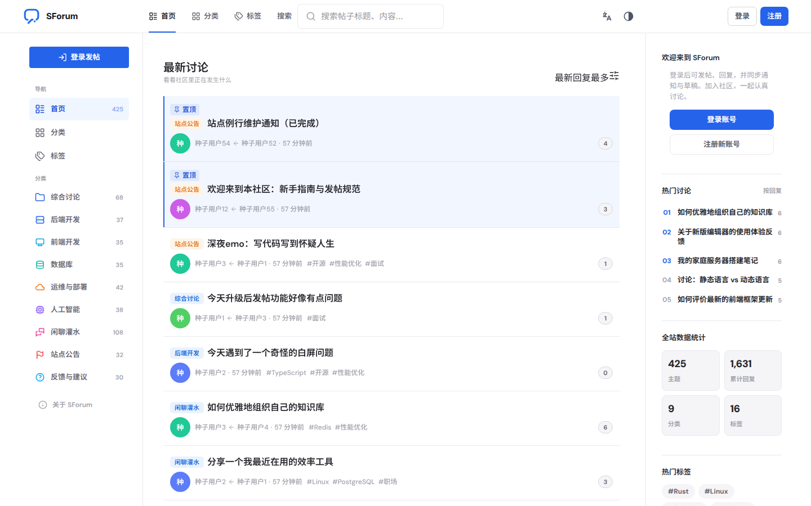
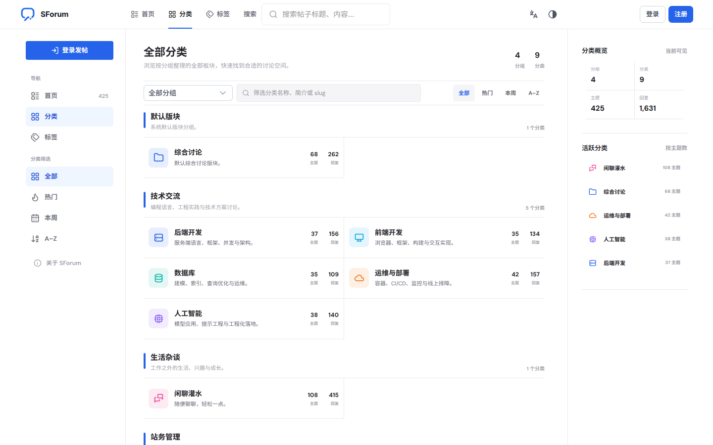
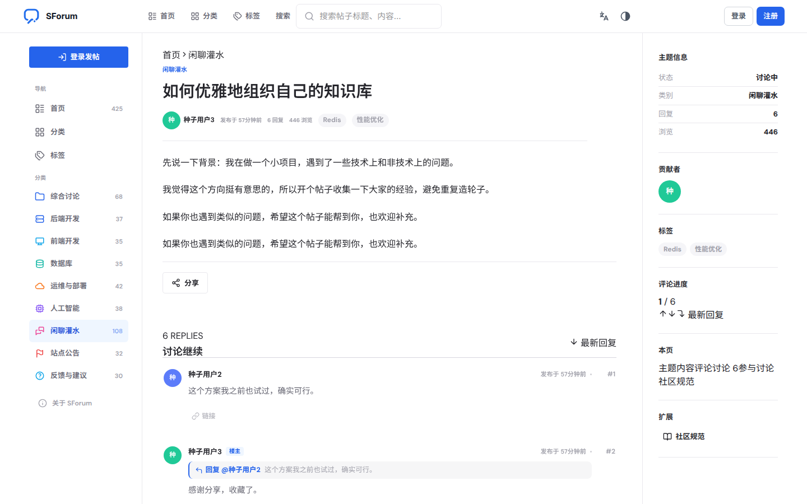
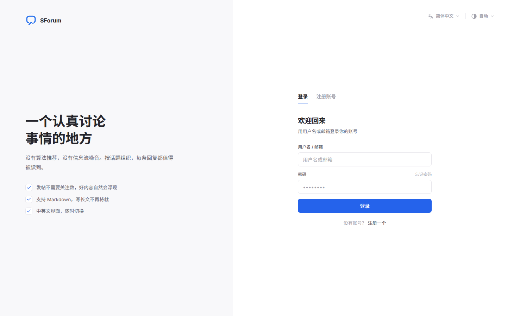
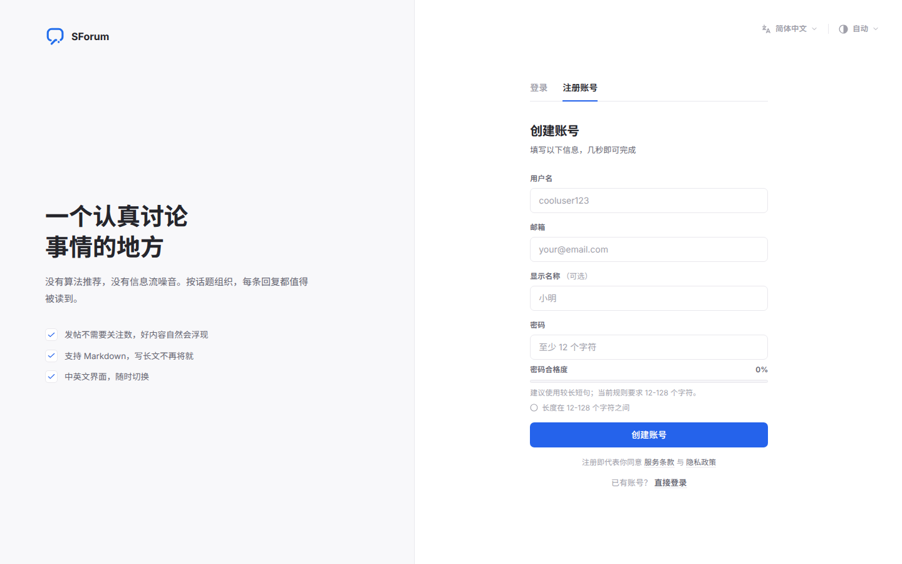
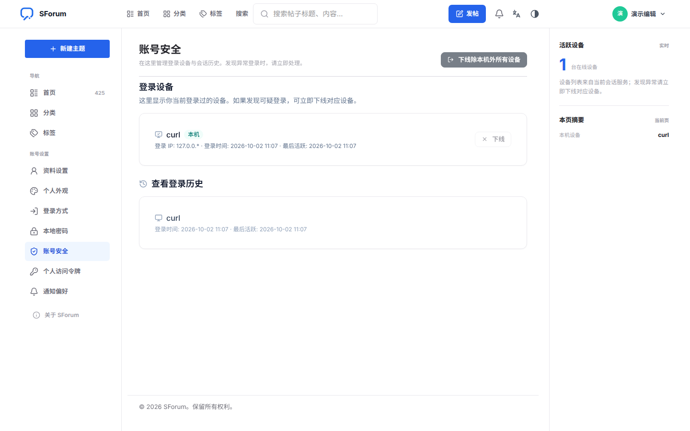
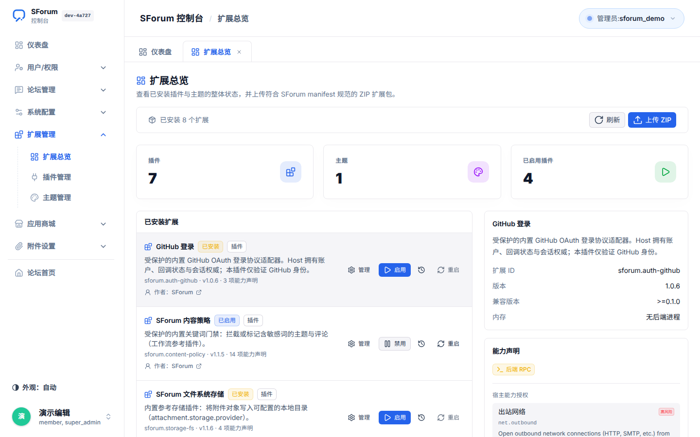

# SForum

Maintainable, plugin-first open-source forum framework.

Core is the host (identity, forum primitives, permissions, extension runtime, contracts). Deployment-specific behavior—mail transport, optional search engines, storage vendors, and similar—lives in extensions.

## Screenshots

### Forum home
Topic feed, category navigation, and live site statistics.



### Categories
Every board grouped by section, with topic and reply counts.



### Topic and discussion
Article body, tags, and threaded replies, with theme-injected extensions in the right rail.



### Composer
Rich-text toolbar, draft controls, pre-publish checks, and publishing settings on one screen.


### Sign in and sign up
Account entry with password strength checks, locale, and appearance controls.





### Account security
Login devices, active sessions, and sign-in history for the current member.



### Admin · Extension overview
Plugin and theme status, host capability declarations, and ZIP upload from the control panel.



## Documentation

| Language | Start here |
| --- | --- |
| **简体中文** | [`docs/zh-CN/README.md`](./docs/zh-CN/README.md) |
| **English** | [`docs/en-US/README.md`](./docs/en-US/README.md) |
| Hub | [`docs/README.md`](./docs/README.md) |

Quick paths:

- [快速开始](./docs/zh-CN/getting-started.md) / [Getting started](./docs/en-US/getting-started.md)
- [使用说明](./docs/zh-CN/usage/README.md) / [Usage](./docs/en-US/usage/README.md)
- [开发指南](./docs/zh-CN/development/README.md) / [Development](./docs/en-US/development/README.md)
- [生产部署](./docs/zh-CN/deployment.md) / [Deployment](./docs/en-US/deployment.md)
- Extension technical reference: [`docs/extensions/`](./docs/extensions/)

## Repository map

| Path | Role |
| --- | --- |
| `apps/web` | Nuxt 4 frontend |
| `apps/api` | Go Fiber API with embedded River worker, CLI |
| `contracts/` | OpenAPI + Protobuf |
| `extensions/` | Built-in / optional / dev packages |
| `docs/` | Bilingual handbooks + extension reference |
| `knowledge/` | Decisions, module notes, session handoffs |
| `scripts/` | Dev and test helpers |
| `deploy.sh`, `upgrade.sh`, `sforum-latest.sh` + `compose*.yaml` | Production orchestration, updates, and the verified-latest entry |

## Local development

```sh
./scripts/dev.sh                 # PostgreSQL, Redis, Mailpit + migrations
./scripts/api-dev.sh             # API (embeds worker in dev)
cd apps/web && bun run dev       # Nuxt on :3000
```

Background jobs: the API process always embeds the River worker in development
and production. Worker ownership is not configurable, so saved settings,
SecretStore access, extension runtimes, and queue consumers share one process.

Useful URLs:

- Web: http://127.0.0.1:3000  
- API health: http://127.0.0.1:3000/api/v1/health  
- API ready: http://127.0.0.1:3000/api/v1/ready  
- Mailpit: http://127.0.0.1:18025  

Meilisearch is **optional** (`docker compose --profile search up -d meilisearch`). Default search is built-in site PostgreSQL FTS.

Full steps: [docs/zh-CN/getting-started.md](./docs/zh-CN/getting-started.md) or [docs/en-US/getting-started.md](./docs/en-US/getting-started.md).

## Production

The rolling install entry downloads and verifies the latest stable Release
bootstrap. It then refreshes the complete matching deploy toolkit:

```sh
(
  set -eu
  mkdir -p sforum
  cd sforum
  bootstrap_dir="$(mktemp -d .sforum-bootstrap.XXXXXX)"
  trap 'rm -rf "$bootstrap_dir"' EXIT HUP INT TERM
  curl -fsSLo "$bootstrap_dir/sforum-bootstrap.sh" \
    https://github.com/zhuchunshu/SForum/releases/latest/download/sforum-bootstrap.sh
  curl -fsSLo "$bootstrap_dir/SHA256SUMS" \
    https://github.com/zhuchunshu/SForum/releases/latest/download/SHA256SUMS
  (
    cd "$bootstrap_dir"
    awk '$2 == "sforum-bootstrap.sh" { print }' SHA256SUMS > sforum-bootstrap.sha256
    test "$(wc -l < sforum-bootstrap.sha256 | tr -d '[:space:]')" = 1
    if command -v sha256sum >/dev/null 2>&1; then
      sha256sum -c sforum-bootstrap.sha256
    else
      shasum -a 256 -c sforum-bootstrap.sha256
    fi
    if command -v gh >/dev/null 2>&1; then
      gh attestation verify sforum-bootstrap.sh --repo zhuchunshu/SForum
    fi
  )
  install -m 0755 "$bootstrap_dir/sforum-bootstrap.sh" ./sforum-bootstrap.sh
  rm -rf "$bootstrap_dir"
  trap - EXIT HUP INT TERM
  ./sforum-bootstrap.sh install  # Enter uses the latest stable release
)
```

Never pipe remote shell content into `bash`. Download the bootstrap and its
`SHA256SUMS`, verify the exact filename entry, and only then execute it — see
[docs/zh-CN/deployment.md](./docs/zh-CN/deployment.md) for the full
instructions.

Existing installations update through `./sforum-bootstrap.sh upgrade`. Every
run refreshes the bootstrap and the target Release's complete deploy toolkit
before handing off to `upgrade.sh`. The default resolves to the newest
**stable** Release and is confirmed before any change (`--yes` skips prompts).
Prereleases are never selected implicitly: pass
`--channel prerelease` or an explicit tag. Every choice resolves to an
immutable `vX.Y.Z` tag — floating `latest` images are never used in production
Compose.

For updates that must not trust the bootstrap already on disk, run the
repository-side wrapper from the install directory. This is one copy-paste and
verifies the wrapper's own SHA-256 before executing it:

```sh
# Run inside the install directory. Rerunning replaces the wrapper atomically;
# no manual deletion is needed.
tmp="$(mktemp ./.sforum-latest.XXXXXX)" && \
curl -fsSLo "$tmp" "https://raw.githubusercontent.com/zhuchunshu/SForum/main/sforum-latest.sh?$(date +%s)" && \
curl -fsSLo "$tmp.sha256" "https://raw.githubusercontent.com/zhuchunshu/SForum/main/sforum-latest.sh.sha256?$(date +%s)" && \
mv -f "$tmp.sha256" sforum-latest.sh.sha256 && \
mv -f "$tmp" sforum-latest.sh && \
{ sha256sum -c sforum-latest.sh.sha256 2>/dev/null || shasum -a 256 -c sforum-latest.sh.sha256; } && \
chmod 0755 sforum-latest.sh && \
./sforum-latest.sh
```

Each run resolves the newest Release, downloads and verifies its complete
`sforum-deploy.tar.gz`, syncs every managed toolkit file (`deploy.sh`,
`upgrade.sh`, Compose files, `deploy/scripts`, Caddy examples, `VERSION`) to
that version, backs up the previous files under `.sforum/tooling-backups/`, and
only then delegates to install or upgrade. `--check` lists exactly which files
are missing or stale without writing anything. When `.env.production` exists but
`.deployrc` has no usable version record (for example a manual-Compose install),
the wrapper runs `./deploy.sh --action deploy --version <TAG>` once to rebuild
the managed state instead of stopping inside `upgrade.sh`. `--yes`,
`--channel prerelease`, and `--version <TAG>` behave as they do for the
bootstrap. The script itself is repository tooling, not a Release asset; only
this one wrapper file comes from `main`.

Production uses one API process with an embedded River worker, sharing the
database pool, SecretStore-backed settings, and extension runtime. Existing
standalone Worker containers from older releases are removed during an update;
legacy environment settings cannot disable the API-owned worker.

The first blue/green ingress conversion has a short maintenance window. Later
releases keep API/Web HTTP traffic available when the database is unchanged or
every pending Core migration explicitly declares backward-compatible online
execution; WebSockets may reconnect while durable River jobs remain protected
by the queue during the API slot handoff. Undeclared Core and all River
migrations use the blue/green-aware `deploy.sh` maintenance path.

Full guides:

- [Deployment overview](./docs/en-US/deployment.md) / [中文](./docs/zh-CN/deployment.md)
- [One-click install and update](./docs/en-US/deployment/one-click.md)
- [Manual Compose deployment](./docs/en-US/deployment/manual.md)
- [Environment and secrets](./docs/en-US/deployment/environment.md)
- [Troubleshooting](./docs/en-US/deployment/troubleshooting.md)

## Community

- Report vulnerabilities privately according to [`SECURITY.md`](./SECURITY.md).
- SForum is available under the [`MIT License`](./LICENSE).

## Contributing / agents

1. Read [`AGENTS.md`](./AGENTS.md)  
2. Read [`docs/`](./docs/README.md) for usage and development  
3. Read [`knowledge/index.md`](./knowledge/index.md) for current project memory  
4. Keep OpenAPI, tests, and knowledge notes updated with code changes  
