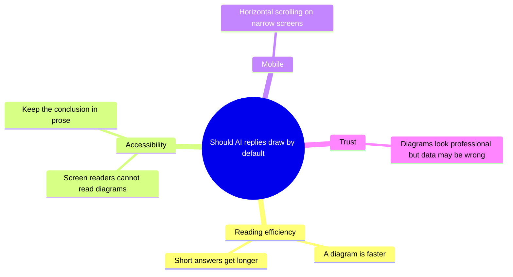

# Rich content fences (diagrams and formulas)

[← Usage](./README.md)

Rich content fences are three kinds of structured content you can write directly in a
body: Mermaid diagrams (mind maps, flowcharts, sequence diagrams, and more), Chart
statistics, and mathematical formulas. They are not shortcodes and add no shortcode
identity: the carrier is an ordinary Markdown code fence or math delimiter. The server
stores the source as written, the browser progressively enhances it after the body
mounts, and any rendering failure falls back to the source instead of leaving a blank
body.

Shortcodes are responsible for "referencing site content and controlling visibility";
rich content is responsible for "drawing structure, data, and formulas". Neither
replaces the other (see [How this differs from shortcodes](#how-this-differs-from-shortcodes)).

## Supported syntaxes (3)

| Kind | Syntax | Purpose | Limits |
| --- | --- | --- | --- |
| Diagram `mermaid` | A ` ```mermaid ` fence | Mind map, flowchart, sequence diagram, state diagram, class diagram, ER diagram, gantt, timeline, pie, journey, quadrant chart | 12 KiB per block; at most 6 blocks of this kind per page |
| Chart `chart` | A ` ```chart ` fence containing JSON | Bar, line, area, pie, doughnut | 8 KiB per block; at most 6 blocks of this kind per page; `labels` and `series` required; at most 6 series and 60 labels; labels, series names, and title at most 120 characters each; each value's absolute value at most 10^12 |
| Formula `math` | Inline `$…$` or `\(…\)`; display `$$…$$` or `\[…\]` | Inline and display formulas, rendered as MathML | 2 KiB per formula; at most 200 per page; macro expansion at most 1000 steps |

Limits are hard limits: content over a limit is not truncated or dropped, it is shown as
source (formulas keep their original text).

### Limits

| Item | Limit |
| --- | --- |
| `mermaid` source per block | 12 KiB (12,288 bytes) |
| `mermaid` blocks per page | 6 |
| `chart` source per block | 8 KiB (8,192 bytes) |
| `chart` blocks per page | 6 |
| `chart` series / labels | 6 / 60 |
| `chart` labels, series names, title | 120 characters each |
| `chart` absolute value | 10^12 |
| Formula source per formula | 2 KiB (2,048 bytes) |
| Formulas per page | 200 |
| Formula macro expansion | 1,000 steps |

### Syntax rules

- The fence language must be `mermaid` or `chart` (case-insensitive). Code blocks without
  a language, indented code blocks, and inline code are not taken over and stay ordinary
  code.
- `mermaid` source follows Mermaid syntax. The site locks the security configuration:
  `securityLevel`, `startOnLoad`, `maxTextSize`, and friends cannot be changed by an
  `%%{init: ...}%%` directive in the source; `click` interactions and scripts do not take
  effect, and the output is sanitized.
- `chart` content is strict JSON and accepts only the six keys `type`, `title`, `labels`,
  `series`, `yLabel`, and `stacked`. An unknown key, a length mismatch between `labels`
  and `series[].data`, or a non-finite number marks the whole block as invalid. `type`
  must be one of `bar`, `line`, `area`, `pie`, or `doughnut`.
- Inline `$` has heuristics to avoid false positives: the opening `$` must not be followed
  by whitespace, the closing `$` must not be preceded by whitespace, and the span must not
  cross a blank line; `$5 and $10` stays plain text. `\$` is an escape; an unclosed
  delimiter is treated as text.
- Formulas are not processed inside code blocks, inline code, or existing diagram content;
  fence source is never parsed as a formula a second time.

## Examples

### Diagram



### Chart

```chart
{
  "type": "bar",
  "title": "Topics per category",
  "labels": ["general", "backend", "frontend", "ops"],
  "series": [{ "name": "Topics", "data": [4, 3, 2, 1] }]
}
```

`stacked: true` stacks multiple series in bar, line, and area charts; `yLabel` adds a unit
label to the value axis.

### Formula

```text
Inline: $O(n \log n)$
Display:
$$
T(n) = 2T(n/2) + O(n)
$$
```

In the editor, write a code block with a language label, or paste the fence text above;
write formulas directly in the body, not inside a code block.

## Fallback matrix (public pages)

Every failure falls back to the source with an explanation; nothing throws and nothing
goes blank. Both an over-size block and an exhausted per-page quota use the "Over a limit"
row:

| Case | `mermaid` | `chart` | Formula |
| --- | --- | --- | --- |
| Invalid syntax | Source + "Diagram syntax is invalid; showing source" | Source + the same message | Original text kept |
| Over a limit | Source + "Diagram exceeds the size limit; showing source" | Source + the same message | That formula is not converted; original text kept |
| Unsupported | Not applicable: unknown syntax is treated as invalid | Source + "Diagram type is not supported; showing source" | Not applicable: unknown commands are treated as invalid |
| CSP | Source + "Rendered as source under this page's security policy" | Renders normally (canvas) | Renders normally (MathML) |
| Render error | Source + "Diagram failed to render; showing source" | Source + the same message | Original text kept |
| No JS / script not executed | Ordinary code block (source) | Ordinary code block (source) | Raw text (`$…$` visible) |

After a fallback the fence source opens automatically and can still be copied; after a
successful render it stays collapsed behind "View source" and does not disappear.

## CSP

A default public page sends no document CSP, so diagrams render normally. When a page
mounts L2 extension components, the host aggregates a `Content-Security-Policy` from the
components actually mounted on that page (its baseline includes `style-src 'self'`) and
sends it as an SSR response header:

- The SVG produced by Mermaid relies on inline `<style>` and is blocked by that policy, so
  it **degrades to source** with "Rendered as source under this page's security policy".
- Formulas render as MathML and charts draw on a canvas; neither relies on inline `<style>`
  style sheets, so both keep rendering.
- Restoring Mermaid graphics on such pages would require relaxing `style-src`. That is a
  change to the site's security policy and is not relaxed by default.

Whether a page is in this mode depends on whether the theme template emitted the document
policy digest (`data-document-policy-digest`); the body renderer only reads that fact and
does not evaluate the policy itself.

## AI replies and rich content

The AI reply bot may use all three syntaxes, but only when a diagram is genuinely clearer
than prose:

- Use `mermaid` for flows, hierarchy, structure, timelines, or mind maps; use `chart` for
  numeric comparisons or trends; use formulas for derivations.
- At most one diagram per answer (the renderer's hard cap of 6 fences of each kind per page
  is not a quota for the AI); diagram text uses the asker's language; no chart without real
  data.
- Numbers in a chart may come only from tool results or data supplied by the asker. They
  must not be invented; when the asker's impression conflicts with tool results, tool
  results win.
- Do not emit HTML, SVG, or image links to "draw" a diagram; they are not executed or
  loaded.
- **The AI does not write shortcodes.** Shortcodes such as `[topic]`, `[user]`, and
  `[login]` exist for humans to reference site content and control visibility; the model
  has no reliable IDs and must not guess them. When it needs to cite something, it uses
  the links in tool results.

This teaching is owned by the host: it sits at a fixed position in the system prompt
(`base → rich content → tools → safety footer`), and an operator overriding the base
prompt cannot remove it. Turning the AI's rich content ability off entirely requires a
code change (see below).

## How this differs from shortcodes

| Dimension | Shortcodes | Rich content fences |
| --- | --- | --- |
| Carrier | Tags such as `[user ...]` and `[login]...[/login]` | ` ```mermaid `, ` ```chart `, `$…$` |
| Purpose | Reference site entities and control visibility | Draw structure, data, and formulas |
| Author | Humans insert them in the editor; the AI does not | Humans and the AI both may |
| Parsing | The server converts them into normalized document nodes | Browser progressive enhancement; the server keeps the source |
| Failure | Host placeholder or literal text | Falls back to source with a reason |
| Operator switch | Plugin enable/disable | No setting; disabling is code-level wiring |

## Operations

### No settings

Rich content rendering is a built-in Web frontend capability released with the frontend
build: there is no admin switch, no parameter, and no "restore recommended defaults"
button. Limits come from the contract file `contracts/fixtures/rich-content-v1.json` and
its frontend mirror; they are not site settings and cannot be tuned per site.

### Disabling and rollback (code-level)

- To disable rendering, remove the rich content wiring (`enhanceRichContent`) from
  `apps/web/app/plugins/highlight.client.ts` and rebuild the frontend. Fences then show as
  ordinary code blocks and formulas show as raw text.
- Disabling rendering without changing the prompt means the AI may still write fences; the
  page simply does not draw them and does not error.
- Rolling back to an older frontend returns to "everything shows as code or plain text";
  content is unaffected.

### Content, search, and caching

- Diagram and formula source is treated like code blocks: it enters plain text, excerpts,
  and search text. This is a known tradeoff; if excerpt noise becomes a problem, the host
  needs a separate exclusion pass.
- Rendering happens in the browser; the server does not generate images. SSR output and
  crawlers see the source.
- Heavy dependencies (Mermaid, Chart.js, KaTeX) are imported on demand; fences render only
  when near the viewport, formulas render as the body mounts. A site with diagrams does
  not slow every page.

### Security boundaries

- Mermaid runs at its strict security level; init directives in the source cannot change
  the security configuration, and the output is sanitized so scripts and clickable nodes
  do not take effect.
- Charts accept only a narrow schema and never pass arbitrary chart-library options
  through; values, label counts, and lengths are all bounded.
- Formulas disable trust (`trust: false`) and cap macro expansion so malicious input
  cannot blow up rendering.
- Visibility of protected content (`login`/`reply`/`only-author`) is still decided by
  shortcodes and server policy; rich content does not bypass it.
