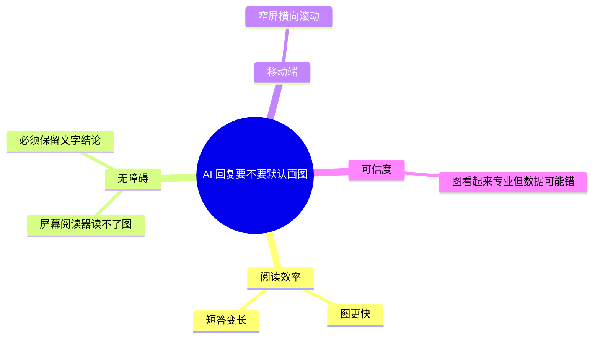

# 富内容围栏（图表与公式）

[← 使用说明](./README.md)

富内容围栏是正文里可以直接书写的三类结构化内容：Mermaid 图（脑图、流程图、时序图等）、
Chart 统计图与数学公式。它们不是短代码，也不新增短代码身份：载体就是 Markdown 的
代码围栏与公式定界符，服务端按原样保存，浏览器在正文挂载后渐进增强为图形；渲染失败
时一律回落到源码，正文不会空白。

短代码负责「引用站内内容与控制可见性」，富内容负责「把结构、数据与公式画出来」，
两者互不替代（见[与短代码的区别](#与短代码的区别)）。

## 支持列表（3 类）

| 类型 | 写法 | 作用 | 上限 |
| --- | --- | --- | --- |
| 图 `mermaid` | ` ```mermaid ` 围栏 | 脑图、流程图、时序图、状态图、类图、ER 图、甘特图、时间线、饼图、旅程图、象限图 | 单块 12 KiB；同类每页最多 6 块 |
| 统计图 `chart` | ` ```chart ` 围栏，内容为 JSON | 柱状图、折线图、面积图、饼图、环图 | 单块 8 KiB；同类每页最多 6 块；`labels` 与 `series` 必填；最多 6 条序列、60 个标签；标签、序列名与标题各不超过 120 字符；单个数值绝对值不超过 10^12 |
| 公式 `math` | 行内 `$…$` 或 `\(…\)`；块级 `$$…$$` 或 `\[…\]` | 行内与独立成行的数学公式，输出 MathML | 单条 2 KiB；每个页面最多 200 条；宏展开不超过 1000 步 |

上限是硬限制：超出的内容不会被截断或丢弃，而是按源码显示（公式保留原文）。

### 上限表

| 项目 | 上限 |
| --- | --- |
| `mermaid` 单块源码 | 12 KiB（12,288 字节） |
| `mermaid` 每页块数 | 6 |
| `chart` 单块源码 | 8 KiB（8,192 字节） |
| `chart` 每页块数 | 6 |
| `chart` 序列 / 标签 | 6 条 / 60 个 |
| `chart` 标签、序列名、标题 | 各 120 字符 |
| `chart` 单个数值绝对值 | 10^12 |
| 公式单条源码 | 2 KiB（2,048 字节） |
| 公式每页条数 | 200 |
| 公式宏展开 | 1,000 步 |

### 语法规则

- 围栏语言必须标为 `mermaid` 或 `chart`（大小写不敏感）。没有语言标记的代码块、
  缩进代码块与行内代码不会被接管，仍按普通代码显示。
- `mermaid` 源码按 Mermaid 语法书写。站点锁定安全配置：`securityLevel`、
  `startOnLoad`、`maxTextSize` 等不能被源码里的 `%%{init: ...}%%` 改写；
  `click` 交互与脚本不会生效，输出还会经过清洗。
- `chart` 的内容是严格 JSON，只接受 `type`、`title`、`labels`、`series`、`yLabel`、
  `stacked` 六个键；出现未知键、`labels` 与 `series[].data` 长度不一致、数值非有限值，
  整块判为语法错误。`type` 只能是 `bar`、`line`、`area`、`pie`、`doughnut`。
- 公式的行内 `$` 有防误判规则：开 `$` 后不能紧跟空白，闭 `$` 前不能是空白，中间不能
  跨空行；`$5 和 $10` 会按普通文本处理。`\$` 是转义；未闭合的定界符整体按文本显示。
- 公式不处理代码块、行内代码与已有图表内部的文本；围栏源码也不会被当作公式再次解析。

## 语法示例

### 脑图



### 统计图

```chart
{
  "type": "bar",
  "title": "各分类主题数",
  "labels": ["general", "backend", "frontend", "ops"],
  "series": [{ "name": "主题数", "data": [4, 3, 2, 1] }]
}
```

`stacked: true` 可把柱状图、折线图与面积图的多条序列堆叠；`yLabel` 用于给纵轴加
单位说明。

### 公式

```text
行内：$O(n \log n)$
块级：
$$
T(n) = 2T(n/2) + O(n)
$$
```

在编辑器里用带语言的代码块书写，或直接粘贴上面的围栏文本即可；公式直接写在正文里，
不要放进代码块。

## 回落矩阵（公开页面）

失败一律回落源码并给出说明，不抛错、不空白。单块超字节与每页配额用尽都走「超限」
这一行：

| 情况 | `mermaid` | `chart` | 公式 |
| --- | --- | --- | --- |
| 语法错 | 源码 +「图表语法有误，已显示源码」 | 源码 + 同一说明 | 保留原文 |
| 超限 | 源码 +「图表超出大小限制，已显示源码」 | 源码 + 同一说明 | 该条不转换，保留原文 |
| 不支持 | 不适用：不认识的语法按「语法错」处理 | 源码 +「暂不支持该图表类型，已显示源码」 | 不适用：未知命令按「语法错」处理 |
| CSP | 源码 +「当前页面安全策略下以源码显示」 | 正常渲染（canvas） | 正常渲染（MathML） |
| 渲染异常 | 源码 +「图表渲染失败，已显示源码」 | 源码 + 同一说明 | 保留原文 |
| 无 JS / 脚本未执行 | 普通代码块（源码） | 普通代码块（源码） | 原样文本（`$…$` 可见） |

回落后图块的源码会自动展开，仍可复制；渲染成功时源码折叠在「查看源码」里，也不会
消失。

## CSP 说明

默认的公开页面不下发文档 CSP，图表正常渲染。当页面挂载了 L2 扩展组件时，宿主会按该页
实际挂载的组件聚合出一份 `Content-Security-Policy`（基线包含 `style-src 'self'`），
并随 SSR 响应头下发：

- Mermaid 产出的 SVG 依赖内联 `<style>`，会被这份策略拦截，因此**降级为源码显示**，
  并提示「当前页面安全策略下以源码显示」。
- 公式输出 MathML、统计图绘制在 canvas 上，都不依赖内联 `<style>` 样式表，仍然正常
  渲染。
- 要让 Mermaid 在这类页面恢复图形，需要放宽 `style-src`；这属于站点安全策略变更，
  默认不放开。

页面是否处于该模式，取决于主题模板是否输出了文档策略摘要
（`data-document-policy-digest`）；正文渲染层只读取这个事实，不自行判断策略内容。

## AI 回复与富内容

AI 回复机器人可以使用这三类写法，但只在图确实比文字更清楚时使用：

- 需要表达流程、层级、结构、时间线或脑图时用 `mermaid`；需要展示数值对比或趋势时用
  `chart`；数学推导用公式。
- 一个回答最多一张图（渲染层每种类型每页最多 6 个围栏是硬上限，不是给 AI 的配额）；
  图内文字使用提问者的语言；没有真实数据就不画统计图。
- 统计图的数字只能来自工具结果或提问者提供的数据，**不得编造**；提问者的印象与工具
  结果冲突时，以工具结果为准。
- 不输出 HTML、SVG 或图片链接来「画图」；这些不会被执行或加载。
- **AI 不写短代码。** `[topic]`、`[user]`、`[login]` 这类短代码是给人类引用站内内容、
  控制可见性用的；模型拿不到可靠的 ID，也不该猜。需要引用时，AI 用工具结果里的链接。

这段教学由宿主拥有：它固定在系统提示词的「base → 富内容 → 工具 → 安全尾注」顺序里，
运营者覆盖基础提示词也删不掉。要整体关闭 AI 的富内容能力，需要改代码（见下节）。

## 与短代码的区别

| 维度 | 短代码 | 富内容围栏 |
| --- | --- | --- |
| 载体 | `[user ...]`、`[login]...[/login]` 等标签 | ` ```mermaid `、` ```chart `、`$…$` |
| 作用 | 引用站内实体、控制内容可见性 | 把结构、数据与公式画出来 |
| 谁写 | 人类在编辑器里插入；AI 不写 | 人类与 AI 都可以写 |
| 解析位置 | 服务端转换为规范化文档节点 | 浏览器渐进增强；服务端保留源码 |
| 失败表现 | Host 占位或保持原文 | 回落源码并说明原因 |
| 运营开关 | 插件启用/禁用 | 没有配置项；关闭属于代码级接线 |

## 运营说明

### 没有配置项

富内容渲染是 Web 前端的内置能力，随前端构建发布：没有后台开关、没有参数、没有
「恢复推荐配置」按钮。上限来自契约文件 `contracts/fixtures/rich-content-v1.json` 与
前端镜像，不是站点设置，不能按站点调整。

### 关闭与回退（代码级）

- 关闭渲染：在 `apps/web/app/plugins/highlight.client.ts` 中移除富内容接线
  （`enhanceRichContent`）并重新构建前端。此后围栏按普通代码块显示，公式按原文显示。
- 只关渲染不关提示词时，AI 仍可能写出围栏；页面只是不画图，不会报错。
- 回退到旧版前端即回到「全部按代码块/纯文本显示」，内容不受影响。

### 内容、检索与缓存

- 图表与公式源码和代码块同待遇：会进入纯文本、摘要与搜索文本。这是已知取舍；如果
  摘要噪音成为问题，需要在 Host 侧另做剔除。
- 渲染在浏览器完成，服务端不生成图片；SSR 输出与爬虫看到的是源码。
- 重依赖（Mermaid、Chart.js、KaTeX）都按需动态加载；图块滚动到附近才渲染，公式在
  正文挂载时渲染。不会因为站点里存在图表就拖慢所有页面。

### 安全边界

- Mermaid 使用严格安全级别，源码里的初始化指令改不动安全配置；产出经过清洗，脚本与
  可点击节点不会生效。
- 统计图只接受窄 schema，不透传图表库的任意配置；数值、标签数量与长度都有上限。
- 公式关闭信任模式（`trust: false`），宏展开有步数上限，避免恶意输入撑爆渲染。
- 受保护内容（`login`/`reply`/`only-author`）的可见性仍由短代码与服务端策略决定，
  富内容不会绕过它。
